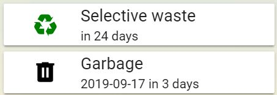
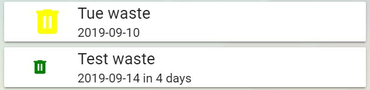

[](https://github.com/hacs/integration)


# Lovelace custom card for Garbage Collection

## End of Support

[Garbage Collection custom integration](https://github.com/bruxy70/Garbage-Collection/), which this custom card has been originally written for, ended support at the begining of 2023. Features supporting [HACS Waste Collection Schedule](https://github.com/mampfes/hacs_waste_collection_schedule) are partial compared to features of Garbage Collection and these can be covered and even surpassed by using the flexible [Custom Button Card](https://github.com/custom-cards/button-card), input boolean and conditional card. Therefore I will end developing and supporting this card after February 2026.

#### Description

This Lovelace custom card displays garbage collection information provided by
the Garbage Collection custom component you may find at
[https://github.com/bruxy70/Garbage-Collection](https://github.com/bruxy70/Garbage-Collection/).<br />
It will draw your attention the day before the garbage collection by changing the icon color to your theme's active icon color by default.

Lovelace UI does not support platform attributes natively.<br />
Implementation of handling attributes in Lovelace was inspired by [entity-attributes-card](https://github.com/custom-cards/entity-attributes-card).

#### Installation
The easiest way to install it is through [HACS (Home Assistant Community Store)](https://github.com/hacs/frontend),
search for <i>garbage</i> and select Garbage Collection Card from Plugins.<br />
If you are not using HACS, you may download garbage-collection-card.js and the translations directory and put them into
homeassistant_config_dir/www/community/garbage-collection-card/ directory.<br />
The card does not support configuration flow, therefore you'll have to add the resources via UI->Configuration
->Lovelace Dashboards->Resources then add the card manually editing the card configuration yaml on the dashboard at
Add Card->Manual.

#### Lovelace UI configuration
Configuration parameters:<br />
---
| Name | Optional | `Default` | Description |
| :---- | :---- | :------- | :----------- |
| entity | **N** | - | name of the sensor of garbage_collection platform.|
| dow_format | **Y** | `long` | Format of the day of week. `long` and `short` are supported. |
| due_color | **Y**| theme's icon active color | icon color on due date. Accepts both color names and RGB values.|
| due_1_color | **Y** | due_color | icon color on the day before due date. Accepts both color names and RGB values.|
| due_txt | **Y** | `false` | For today/tomorrow pick-ups use 'Due today' or 'Due tomorrow'. Has precendence over hide_date and hide_days. |
| icon_color | **Y** | theme's icon color | icon color. Accepts both color names and RGB values.|
| icon_size | **Y** | `25px` | size of the icon.|
| icon_cell_padding | **Y** | `35px` | padding applied to icon cell.|
| icon_cell_width | **Y** | `60px` | icon cell width.|
| hass_lang_priority | **Y** | `false` | whether HASS language has priority over browser language.|
| hide_before | **Y** | `-1` | hide entire card until X days before event. Default: do not hide card.|
| hide_date | **Y** | `false` | hide date.|
| hide_days | **Y** | `false`| hide number of days. Automatically set to true when collection is due today or tomorrow.|
| hide_dow | **Y** | `true`| hide day of the week. Discarded when collection is due today or tomorrow.|
| hide_icon | **Y** | `false`| hide icon. |
| hide_on_click | **Y** | `true`| hide the card upon click when due date is today or tomorrow.|
| hide_on_today | **Y** | `false`| hide the card when due date is today, e.g. collection is early in the morning. |
| hide_title | **Y** | `false`| hide title. |
| title_size | **Y** | `17px` | font size for the sensor's friendly name.|
| details_size | **Y** | `14px` | font size for date and number of days.|
| source | **Y** | `Garbage-Collection` | source of garbage collection data. |
---

`source` for garbage collection data supports fully [Garbage-Collection](https://github.com/bruxy70/Garbage-Collection).
When garbage-collection sensors are used with verbose_state=True, hide_date and hide_days will be discarded,
displayed text will be taken from the sensor's verbose_format.

Since Garbage-Collection custom integration has ended its support, a limited support for
[hacs_waste_collection_schedule](https://github.com/mampfes/hacs_waste_collection_schedule) has been added. Such sensor
should have its state set to `{{ value.daysTo }}` and `details_format` set to `generic`. If the sensor doesn't limit the
type of garbage, the first one with the nearest due date will be displayed. See examples below.

Garbage collection card supports some languages and displays the date information based on your locale setting by default.
You may override this to use the language set in HASS for displaying its frontend.

When garbage collection is today or tomorrow, clicking on the card you can acknowledge that the
garbage was prepared or collected and the card will be hidden until the day after due day or if hide_before
is used, until X days before next due day.

Please add the card to the resources in configuration.yaml:

```
resources:
  //When using HACS installation method
  - {type: module, url: '/hacsfiles/garbage-collection-card/garbage-collection-card.js'}
  //When using manual install method
  - {type: module, url: '/local/garbage-collection-card.js'}
```

### EXamples

Please find below an example of ui-lovelace.yaml for a sensor with data coming from Garbage-Collection custom integration
(entity should be the sensor of garbage_collection platform you defined):

```
    cards:
      - type: custom:garbage-collection-card
        entity: sensor.selective_waste
        icon_size: 35px
        icon_color: green
        hide_date: true
      - type: custom:garbage-collection-card
        entity: sensor.waste
        hide_before: 4
        icon_color: '#0561ba'
```

Basic card:<br />


Different icon sizes and colors:<br />


Example of card for a sensor configured with hacs_waste_collection_schedule custom integration:

```
    cards:
      - type: custom:garbage-collection-card
        source: 'hacs_waste_collection_schedule'
        entity: sensor.next_collection
```
Supported sensor configuration:
```
platform: waste_collection_schedule
name: next_collection
details_format: 'generic'
value_template: '{{ value.daysTo }}'
### leadtime just limits the number of items to handle
leadtime: 10
```

## Thanks

Thanks to all the people who have contributed!

[](https://github.com/amaximus/garbage-collection-card/graphs/contributors)
